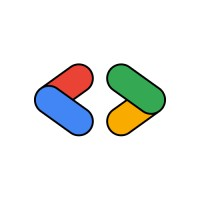
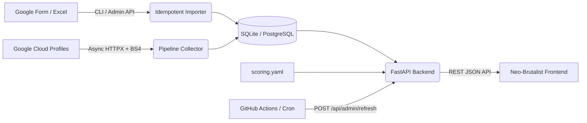

<div align="center">

  

  # ☁️ GDG Cloud Leaderboard & Tracking Platform
  ### BMS Institute of Technology & Management (BMSIT&M)

  **An automated, resilient badge tracking and neo-brutalist live leaderboard for Google Cloud Study Jams & Skill Boost Campaigns.**

  [](https://python.org)
  [](https://fastapi.tiangolo.com)
  [](tests/)
  [](frontend/)
  [](LICENSE)

  [Live Demo](#-live-interface) • [Key Features](#-key-features) • [Scoring Rules](#-scoring--ranking-rules) • [Tech Stack](#-tech-stack) • [Quickstart](#-quickstart--local-development) • [Creators](#-creators--credits)

</div>

---

## 📌 Overview

The **GDG Cloud Leaderboard** is an end-to-end automation and public leaderboard service designed for Google Developer Groups (GDG) On Campus at **BMSIT&M**. 

During Google Cloud campaigns (such as Study Jams or Skill Lab challenges), students complete hands-on labs and earn digital badges on Google Cloud Skills Boost. Tracking hundreds of participant profiles manually is error-prone and tedious.

This platform automates the entire lifecycle:
1. **Intelligent Ingestion**: Imports Google Form participant responses with deduplication and URL canonicalization.
2. **High-Throughput Scraping**: Asynchronously inspects verified public profiles without heavy headless browsers.
3. **Scoring & Verification**: Categorizes badges, applies date filters, checks criteria, and breaks ties dynamically.
4. **Neo-Brutalist Presentation**: Serves a responsive, lightweight live leaderboard with search, podium rankings, and badge breakdown modals.

---

## ✨ Key Features

### 🎨 Neo-Brutalist Live Frontend
- **High-Contrast Design**: Distinct retro-modern brutalist aesthetics featuring sharp borders, offset box shadows, vibrant palette tags, and custom typography.
- **Top 3 Dynamic Podium**: Interactive podium showcasing the gold, silver, and bronze leaders with high-visibility badges and point counters.
- **Real-Time Client Search**: Instant search by student name or college department with zero server roundtrips.
- **Detailed Participant Modal**: Click any student to view their verified badges, category tags, earn dates, and public profile links.
- **Mobile Responsive**: Custom media query breakpoints ensuring fluid display from mobile screens to 4K displays.

### ⚙️ Scalable & Resilient Pipeline
- **Lightweight Asynchronous Scraper**: Built using `httpx` and `BeautifulSoup4` (`lxml`). Fetches raw HTML profiles directly with connection pooling, exponential backoff, jitter, and automatic retry handling.
- **Safe State Persistence**: If a student's profile fetch encounters a transient network issue or 404, their existing badges are preserved and marked `stale` — ensuring an intermittent outage never zeroes out student progress.
- **Strict Data Validation Gate**: Runs are only published if the success ratio exceeds `MIN_SUCCESS_RATIO` (default 60%) and unclassified `other` badges remain under threshold, preventing corrupted leaderboards if Google updates their HTML structure.
- **Scoring Audit Trail**: Each pipeline run logs a SHA-256 hash snapshot of the active `scoring.yaml` rules for full transparency and reproducibility.

### 🔒 Privacy-First Architecture
- **Student Privacy Guaranteed**: USNs (University Seat Numbers), email addresses, and private student identifiers are strictly confined to administrative operations.
- **Sanitized Public API**: All public API endpoints strip internal identifiers, serving only display names, verified badge counts, and public profile links.

### ⏰ Automated Operations
- **GitHub Actions Scheduled Sync**: Automatically triggers a backend sync daily at **02:00 AM IST** (`30 20 * * *` UTC) and on every push or merge to the `main` branch.
- **APScheduler Background Jobs**: Built-in cron scheduler for standalone deployments with database concurrency locking.

---

## 🏆 Scoring & Ranking Rules

Scoring is completely decoupled from application code and managed via [`scoring.yaml`](scoring.yaml):

| Badge Category | Points | Description |
| :--- | :---: | :--- |
| **Skill Badge** | **10 pts** | Hands-on challenge lab assessments on Google Cloud Skills Boost. |
| **Game / Arcade Badge** | **5 pts** | Trivia, Arcade games, and Level milestone badges. |
| **Course Badge** | **3 pts** | Regular course completion badges. |

### 🎯 Ranking & Tie-Breaker Logic
1. **Completion Milestone**: The **first participant to complete all badges** (earliest timestamp reaching final score) secures **Rank #1** on the podium.
2. **Subsequent Finishers**: Any other participants who complete all badges are placed directly below Rank #1 in **alphabetical order**.
3. **Active Contenders**: All remaining participants are ranked by **Total Points (descending)**, then **Skill Badges (descending)**, and finally by **Name (alphabetical)**.
4. **Program Eligibility**: Only badges earned within the program window (after **October 13th, midnight / Oct 14, 2026**) are counted towards points.

---

## 🛠️ Tech Stack



- **Backend**: Python 3.11+, [FastAPI](https://fastapi.tiangolo.com/), [SQLAlchemy 2.0](https://www.sqlalchemy.org/)
- **Database**: SQLite (local/default) or PostgreSQL / Supabase / MySQL (via `DATABASE_URL`)
- **Scraping & Ingestion**: [HTTPX](https://www.python-httpx.org/), [BeautifulSoup4](https://www.crummy.com/software/BeautifulSoup/), `lxml`, `openpyxl`
- **Frontend**: Vanilla HTML5, Modern CSS (Custom Neo-Brutalist design system), Vanilla ES6+ JavaScript
- **Task Scheduling**: APScheduler (in-process) & GitHub Actions (external trigger)
- **Containerization & Hosting**: Docker, Render / Railway / Supabase

---

## 🚀 Quickstart & Local Development

### 1. Clone & Set Up Virtual Environment

```bash
# Clone the repository
git clone https://github.com/Berserker-GM/GDG.git
cd GDG

# Create and activate virtual environment
python -m venv .venv

# Linux / macOS
source .venv/bin/activate
# Windows
.venv\Scripts\activate

# Install dependencies
pip install -r requirements-dev.txt
```

### 2. Configure Environment

```bash
cp .env.example .env
```

Key environment variables:
- `ADMIN_TOKEN`: Secret key for administrative endpoints.
- `CONTACT_EMAIL`: Email included in User-Agent header for courteous scraping.
- `SCORING_CONFIG`: Path to scoring config (default: `scoring.yaml`).
- `DATABASE_URL`: Defaults to local SQLite (`sqlite:///data/leaderboard.db`).

### 3. Run the Test Suite

All network requests are mocked with `pytest` for deterministic, offline testing:

```bash
python -m pytest
```

### 4. Seed Synthetic Data (Offline Demo)

You can generate synthetic participant submissions and run a local mock pipeline:

```bash
# Generate mock participants and team CSV
python scripts/generate_sample_form.py data/sample_form.xlsx --teams data/sample_teams.csv

# Import into local database
python -m app.cli import data/sample_form.xlsx --teams data/sample_teams.csv

# Execute offline refresh against mocked Google profiles
python scripts/mock_refresh.py
```

### 5. Start the Local Server

```bash
python -m app.cli serve --host 127.0.0.1 --port 8000
```

Open [http://localhost:8000](http://localhost:8000) in your browser to view the live neo-brutalist leaderboard. Interactive API documentation is available at [http://localhost:8000/docs](http://localhost:8000/docs).

---

## 🌐 API Overview

### Public Endpoints (No Authentication Required)
- `GET /` — Serves the frontend web interface.
- `GET /health` — Service healthcheck and database connectivity status.
- `GET /api/leaderboard?limit=50` — Current published standings, podium leaders, and score breakdowns.
- `GET /api/leaderboard/status` — Pipeline status, last sync timestamp, and link health statistics.
- `GET /api/members/{member_id}` — Detailed badge breakdown and verification history for a single participant.

### Admin Endpoints (Requires `X-Admin-Token` header)
- `POST /api/admin/refresh` — Triggers an asynchronous scraping and ranking pipeline run.
- `POST /api/admin/import` — Ingests a new `.xlsx` form export with automated upserts.
- `GET /api/admin/link-report` — Exports a CSV audit report of all profile URLs and validation statuses.

---

## 📂 Project Directory Structure

```text
├── .github/workflows/       # GitHub Actions (daily-refresh.yml, test.yml)
├── app/
│   ├── api.py               # FastAPI application & route controllers
│   ├── cli.py               # Command-line administrative tooling
│   ├── config.py            # Environment settings & configuration loader
│   ├── db.py                # Database connection & session lifecycle
│   ├── models.py            # SQLAlchemy declarative ORM models
│   ├── pipeline.py          # Lock -> Scrape -> Score -> Validate -> Publish
│   ├── scoring.py           # Scoring rules engine & tie-breaking algorithms
│   ├── importer.py          # Google Form (.xlsx) idempotent parser
│   ├── urls.py              # Profile link normalization & sanitization
│   └── collectors/          # Public profile scrapers & parser logic
├── docs/
│   └── RUNBOOK.md           # Production deployment & operations runbook
├── frontend/
│   ├── index.html           # Neo-brutalist single-page application
│   └── gdg-logo.png         # GDG On Campus branding asset
├── scripts/                 # Synthetic data generators & mock helpers
├── tests/                   # Pytest comprehensive test suite (100+ tests)
├── scoring.yaml             # Declarative point weights & program dates
└── requirements.txt         # Production dependencies
```

---

## 👥 Creators & Credits

Crafted with ❤️ for the Google Cloud developer community at **BMSIT&M**:

| Creator | Profile Links |
| :--- | :--- |
| **Mohit** (Galaba Mohit) | [](https://github.com/Berserker-GM) [](https://www.linkedin.com/in/galaba-mohit-950691380/) |
| **Parasmani** (Parasmani Kushwaha) | [](https://github.com/parasmani-dev) [](https://www.linkedin.com/in/parasmanikushwaha) |

**Community**: [Google Developer Groups (GDG) On Campus — BMS Institute of Technology & Management](https://bmsit.ac.in)

---

## 📄 License

This project is open-source under the [MIT License](LICENSE).
Feel free to use and adapt this system for your university or community GDG events!
